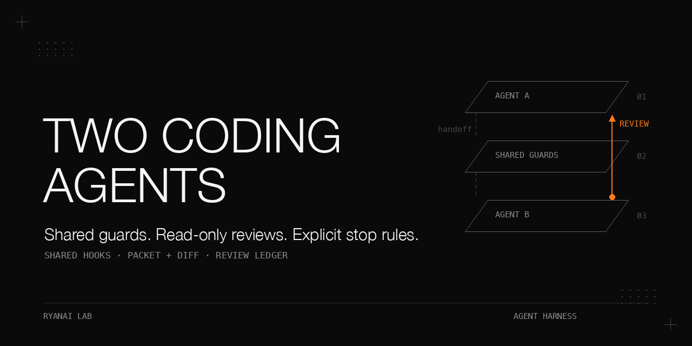

# Two coding agents side by side

One set of guards, a read-only reviewer from the other vendor, and a record of when review should stop.

Running a terminal coding agent (agent A) beside another vendor's coding agent (agent B) pays off only when shared guards really share files, the reviewer has a bounded subject and a working invocation, and the stopping decision is explicit. In the histories here, a routing review reached zero blocker/major findings on round 9, while a privacy scanner still produced findings after 26 rounds. This book follows those failures through their mechanisms, procedures, results, and limits. The scripts are public extractions with synthetic fixtures; the historical measurements are not results of running those fixtures.

## Why this matters

A second opinion can inherit the first agent's broken guard, spend its context exploring the wrong subject, or report that it verified a source despite having no tools. More reviewers do not repair those conditions.

The useful unit is an inspectable review: shared guard files, harness-written execution records, a packet plus a diff, an explicit runtime configuration, source checks with declared access, and a per-round ledger. Green tests and repeated findings then become evidence to interpret rather than automatic acceptance signals.

## What is in this book

| Chapter | What it establishes |
|---|---|
| [Shared guards](docs/shared-guards.md) | Link the files, map harness events, and adapt the Stop output protocol. |
| [Reviewer lane](docs/reviewer-lane.md) | Isolate caller configuration, bound the review with files, and test an exact reply. |
| [Model and effort](docs/model-selection.md) | Evaluate on your own tasks and distinguish measurements from cost arithmetic. |
| [Open-book plans](docs/open-book-review.md) | Give evidence to every reviewer and actual source access to at least one. |
| [Source audits](docs/source-audits.md) | Check what citations mean, not merely whether their identifiers exist. |
| [Convergence](docs/convergence.md) | Track confirmed findings, fixes, regressions, and reachable acceptance criteria. |

[Results](docs/results.md) retains complete historical tables and their conditions. [Pitfalls](docs/pitfalls.md) expands the failure-to-repair map.

## The setting

The recorded hooks and reviewer lane ran on one personal Mac workstation with macOS. Open-weight reviews went through a local chat-completions-compatible gateway forwarding to cloud providers. No GPU is needed for these examples.

| Component | Recorded version or behavior | Boundary |
|---|---|---|
| Agent A | Terminal coding agent; JSON on hook stdin | Version not recorded. |
| Agent B | CLI 0.153.4 inspected during 2026-09-25 to 2026-10-03 | Hook schema and rollout format are version-sensitive. |
| Historical wrapper | Written against 0.144.1; re-checked on 0.147.0 on 2026-08-16 | Catalog shape checked only for self-test in the 0.147 to 0.153.4 range. |
| Third-party router | 2.0.0 | Relevant to the configuration-rewrite incident. |
| Shell | bash 3.2 | Empty arrays under `set -u` need the supplied expansion idiom. |
| Python | Standard library; 3.14.6 used for fact-record example verification | No live account is needed for the public tests. |
| Reviewers | Agent B flagship tier at highest effort; three open-weight reasoning models | Names and availability were account- and date-specific. |

For live use, both agents need hooks and a non-interactive `exec` mode. The main wrapper needs a repository and a valid account-specific model/provider configuration. Authentication setup, current model availability, and current vendor schema compatibility are unknown here. The offline path below needs only Python and bash.

## Chapter 1: One set of guards for two agents

**Problem.** Hand-copied hooks drifted, and a shared log reader understood only agent A. The incident, mirror probe, and 237-session/30-rollout replay are summarized in [agent-guards-that-fail-silently](https://github.com/ryangu00/agent-guards-that-fail-silently), cases 9/10. This chapter adds the event mapping, Stop protocol, trust boundary, link script, and runnable parser.

**Mechanism.** Make each same-named agent-B hook a symbolic link to agent A's file; keep the previous file as `<name>.bak-<date>-sync`. Leave B-only files alone and retain the command paths in B's hook configuration. Compare bytes with `filecmp.cmp(shallow=False)` to catch a link replaced by a divergent regular file.

The rollout reader recognizes B by its hidden directory component or a first-line `session_meta`. It accepts only `event_msg` records with `payload.type == "item_completed"`. Model-composed `custom_tool_call` and `custom_tool_call_output` text is not execution evidence.

| Harness item | Mapping | Detail |
|---|---|---|
| `CommandExecution` | `Bash` with direct result | Use `argv[2]` after `-lc`/`-c` when present; otherwise `shlex.join(argv)`. |
| Command output | `result_text`, `exit_ok`, `is_error` | `aggregated_output`, then `stdout`; integer nonzero exit means error. |
| `FileChange` | `Write` for add; `Edit` otherwise | Added content, or `+` diff lines excluding `+++`, becomes `new_string`. |
| `McpToolCall` | `mcp__<server>__<tool>` | Preserve `arguments`. |
| `WebSearch` | `WebSearch` | Preserve `query`. |
| `AgentMessage`, `UserMessage`, `Reasoning` | No event | They establish neither execution nor a receipt. |

Agent B 0.153.4 has a strict Stop output schema: `continue`, `decision`, `reason`, `stopReason`, `suppressOutput`, and `systemMessage` are accepted; `hookSpecificOutput` is not. Its Stop input additionally requires `last_assistant_message`. Use `{"systemMessage": "..."}` for B and `hookSpecificOutput.additionalContext` for A. B's `systemMessage` reaches the human only; SessionStart supports `additionalContext` for model-visible context.

**Procedure as run.** On 2026-09-25, classify each directory diff as an upstream fix or an intentional adaptation, then replace the copies with links and retain backups. On 2026-09-27, inspect the harness records, add the mapping and Stop branch, and make the daily auditor share that parser. Its legacy fallback ran only when no `item_completed` existed, avoiding double counting.

| Observation | Result | Condition |
|---|---|---|
| Same-named hooks / intentional differences | 12 / 0 | Segment comparison, 2026-09-25. |
| Rollouts examined | 89 | Last 5 days as of 2026-09-27. |
| Model-composed JavaScript calls | 95% | Same 89-rollout sample. |
| No `item_completed` events | 3 of 89 | Sessions started through MCP-server mode. |
| Original synthetic parser check | 8 lines | Metadata and forged call ignored; successful/failing commands and file changes mapped; original functions checked 2026-10-03. |

**What did not work.** Copies plus occasional synchronization left old behavior active. A byte-identical replacement escapes a byte-only mirror until its first divergent edit. The original mirror raised on a dangling link; this extraction reports a per-file alert and offers `--require-links`. The original parser still treated unsupported sessions as clean; this extraction reports `unparsed` when nonempty input yields no events.

**Trust limit.** Vendor documentation quoted in the record ties approval to the hook definition, not script bytes. Editing a linked script therefore need not prompt for approval again. This was not tested separately; the schema extraction method was also not recorded.

**Rule.** Share the file, test both host payloads after edits, and accept execution evidence only from harness-written records. A successful parse is not a receipt-validation policy.

## Chapter 2: A read-only reviewer lane that survives config rewrites

**Problem.** Other tools rewrote the second agent's provider, model, metadata catalog, and later its sandbox defaults. Reviews also exhausted context exploring the repository before reaching a verdict.

**Mechanism.** The caller supplies a complete invocation instead of repairing a configuration file that another program owns:

```text
exec --skip-git-repo-check -s read-only --ignore-user-config
-c model_provider=<native-provider> -c model=<account-verified-model>
-c model_catalog_json=<own-valid-catalog> -o <last-message-file>
```

Close stdin with `< /dev/null`. Pass structured-output requests through `--output-schema`. If missing, create the catalog with `id/model/slug`, a 200,000-token context window, and `effective_context_window_percent: 95`; verify that those metadata assumptions fit the actual model before live use.

Generate a handoff packet containing repository, base, head, clean-worktree status, changed-file statistics, and commit subjects. Append the complete diff. Ask for findings as file:line, defect, and failing scenario; check the packet's claims against the diff; finish SOUND / NEEDS CHANGES / UNSOUND in under 500 words. Say "cannot tell from the diff" when evidence is absent.

The daily self-test calls the agent with `Reply with exactly: LANE_OK`, counts exact reply lines with `grep -cx`, and rejects metadata warnings. The historical daily job imposed a 180-second timeout. A substring match can pass on the echoed prompt; zero warnings can mean the process died before reviewing anything.

**Untested live proposal.** The public wrapper adds `-c model_reasoning_effort=<level>` and asserts exact `model:` and `reasoning effort:` banner lines. This addition is tested against a stub only. The historical wrapper had no effort pin, and its proposed repair has not been validated with a live CLI.

**Procedure as run.** Diagnose the rewritten provider and catalog on 2026-07-31, compare endpoint responses and warning counts, replace repository exploration with packet-plus-diff handoff, and add a real-call daily self-test. On 2026-08-16, the 0.144.1 to 0.147.0 upgrade passed the self-test before and after; the explicit read-only flag remained necessary despite a passing bare invocation that day.

| Measurement | Result | Condition |
|---|---|---|
| Failed dispatches before diagnosis | 7 | 2026-07-31. |
| Starts with no report | 4 | Catalog replacement explained these runs. |
| Router responses | `/v1/messages` 200; `/v1/chat/completions` and `/v1/responses` 404 | Router 2.0.0; B required the responses format. |
| Metadata warnings | 1 with router catalog; 0 with own catalog | One call each. |
| Bare prompt input | 23,990 tokens | 2026-08-16; 5 MCP servers and 30+ plugins. |
| Saved by skipping user config | about 24K tokens per call | Same date; workday notes, single reading. |
| Stub self-test | exact reply passes; echo, warning, and silence fail | Original wrapper checked 2026-10-03. |

**What did not work.** One review started outside a repository, then covered only 82 diff lines and missed most of 7 attack surfaces. A full-bundle round found 2 BLOCKER and 4 MAJOR; the miss cost about 40 minutes. Three later banners printed `reasoning effort: none`, rated PLAUSIBLE as an explanation for shallow review. Another diff added 3,409 lines, including 2,326 lines of prior stderr (about 68%), exposing the reviewer to its own verdict and rebuttals.

Keep artifacts outside the subject. The public wrapper requires an output path and requires a supplied packet when using a standalone diff without a base; it does not guess which commit range matches that diff. Its empty-array expansion remains `${EXTRA[@]+"${EXTRA[@]}"}` for bash 3.2.

**Rule.** Bound the subject and runtime explicitly, then prove liveness with an exact reply. Treat the proposed effort assertion as unvalidated until the actual CLI demonstrates it.

## Chapter 3: Choose model and effort on your own tasks

**Problem.** The initial choice came from public benchmarks, prices, and anecdotes rather than the work being delegated.

**Mechanism.** Separate adversarial review from mechanical extraction. Pin the requested model and effort at the direct runtime call, then check the job's `request.model` or served-model banner. A forwarding layer had rewritten both flags and model names. Names accepted by an account on one date are not availability guarantees.

**Procedure as run.** The review baseline used a pre-fix snapshot from round 8 of the routing series, without revealing the three known issues. The flagship tier ran at highest effort; the task required complete suites, real pass counts, unchanged subject files, and no database writes. The extraction test used `random.Random(20260925)` to generate 80 mixed-language log rows; the answer key was unavailable to the reviewer. The small tier ran once at high effort.

| Test | Findings or accuracy | Usage | Condition |
|---|---|---|---|
| Review baseline | Recorded as 2 of 3 known issues: 1 full, 1 partial, 1 miss; 4 additional real MAJOR; 1 fixture-caused MINOR | 7 minutes; input 1,561,679 (cached 1,422,592); output 21,304 (reasoning 8,878) | n=1; same model had reviewed the case before; run date not separately recorded. |
| Bulk extraction | 80 of 80 rows; each of six fields 80 of 80 | Input 217,265 (cached 184,832); output 4,020 (reasoning 1,645) | n=80 rows, one run, withheld key; run date not separately recorded. |
| Cost comparison | about 47; source rounded to about 48x | Computed on extraction token counts | Flagship extraction not run; rates and cache share determine the ratio. |

The partial review hit missed an entire category row. The additional MAJOR findings were independently re-checked by the operator and fixed. These observations do not establish a recall distribution or completeness.

**What did not work.** A newer tier returned 400 as unavailable to the account. The review wrapper's historical default was an older accepted tier, not the flagship used for this baseline. One run found defects earlier rounds had missed, so choosing a model did not establish that the defect set was exhausted.

The public generator preserves the seed, formats, unit conversion, and enum mapping but uses synthetic node/service tokens and English label phrases. It does not reproduce the historical multilingual difficulty. The six extracted fields are accompanied by a separate line index. Keep the generated key outside the reviewer's input directory and access scope.

**Rule.** State the task, sample size, access, served model, and effort. Distinguish measured output from computed savings and from a proposal about future runs.

## Chapter 4: Plan review must be open-book

**Problem.** A closed-book panel could check a design's internal consistency but could not check its account of recent methods or API behavior.

**Mechanism.** Give every reviewer the plan and evidence pack. Require a verdict and the three most important changes first, then claim-by-claim comparisons and declared knowledge gaps. Give at least one reviewer actual source-fetching access. Write a credibility table before reconciling findings: tool execution, evidence-pack reading, and unsupported narration are different evidence classes.

**Procedure as run.** On 2026-09-27, send the same plan to agent B and three tool-less reasoning models. The closed-book prompt forbade commands, files, and network. The open-book round added paper abstracts, the earlier design, measurement records, and an official API description. Only the tool-enabled reviewer could fetch from the allowed preprint API and raw-file domain.

| Item | Closed-book round | Open-book round | Condition |
|---|---|---|---|
| Prompt | 13,626 bytes; plan 12,081 | 58,401 bytes; evidence 46,614 | One plan, 2026-09-27. |
| Tool-enabled execution / tokens | 0 shell executions; 40,129 tokens | 5 shell executions; 84,696 tokens | Read-only/no-network first; workspace-write/network second. |
| Wall time | 2 min 32 s | 3 min 32 s | 12:38:34-12:41:06; 12:50:45-12:54:17. |
| Verdicts | 4 of 4 FIX-FIRST | 4 of 4 FIX-FIRST | Open-book reconciliation includes reruns after empty drafts. |
| Reconciliation | 10 consensus; 8 single-reviewer findings | 10 consensus; 11 single-reviewer findings adopted; 2 rejected | Full adoption/partial counts in results. |

The open-book tool reviewer fetched 7 distinct URLs: a request covering 9 paper identifiers and 6 repository files. All 9 identifiers matched their titles; full papers were not read. A tool-less reviewer claimed `curl` verification three times and claimed two identifiers were missing. Those claims were discarded after actual fetching showed the identifiers existed.

**What did not work.** Two tool-less outputs were empty at `finish_reason=length` with a 20,000-token completion cap. Reruns at 60,000, with verdict-first and short-thinking wording, returned 2,501 and 3,923 characters in 66 s and 196 s. Grepping the whole log for `curl` had counted narration; structured execution records supplied the actual count.

In a later same-day review, reviewers restated attack seeds almost one for one; this was the operator's judgement, not a measurement. Supply axes to investigate rather than conclusions to repeat. The shipped fanout records each attempt's characters, finish reason, token total, and elapsed seconds; it preserves empty failures instead of calling them verdicts.

**Rule.** Make source-dependent plan review open-book and include a reviewer who can check sources. Consensus is not a substitute for that execution path.

## Chapter 5: Audit the sources behind a model-written report

**Problem.** Two reports had valid citations yet misstated what those sources established. Identifier validity was a poor proxy for claim accuracy.

**Mechanism.** Use two lenses: traceability and overreach. For each claim, record CONFIRMED / CONTRADICTED / NOT-FOUND / FETCH-FAILED, compare the quoted wording, and name a concrete repair. Separately flag conclusions beyond the source, claims promoted to measurements, mixed evaluation bases, and consensus without independent support. Hash the reports before and after; a prompt saying read-only is not a sandbox.

**Procedure as run.** On 2026-09-22, a different vendor's reviewer audited both reports with access limited by prompt to the cited public URLs. It reported identical before/after hashes. The editing pass reconciled each finding as APPLY or REJECT; the operator spot-checked the blockers. A method draft written from the corrected reports then received another audit.

| Measurement | Result | Condition |
|---|---|---|
| Initial audit | 10.7 minutes; 27 KB; 34 findings; both FIX-FIRST | Two reports, 2026-09-22. |
| Severity | 4 BLOCKER, 25 MAJOR, 5 MINOR | Review and reconciliation agree; working summary instead said 24 MAJOR, 6 MINOR. |
| Identifier resolution | All 38 arXiv identifiers resolved to the named papers | Does not establish semantic accuracy. |
| Reconciliation | 34 of 34 APPLY; none REJECT; net line changes +2 and -2 | Targeted replacements; 4 blockers spot-checked. |
| Later method draft | 8 findings: 2 BLOCKER, 5 MAJOR, 1 MINOR | 37-row table; 27 rows labeled STANDARD, many with one source. |

The one-rater classification of the initial findings was: 13 misreadings, 10 over-extensions, 3 mixed bases, 2 omitted decisive qualifications, and 1 each for a claim promoted to measurement, reworded quotation, wrong precision, internal inconsistency, formatting, and an informational item. The complete finding-number mapping is in [results](docs/results.md#report-findings-by-error-type).

**What did not work.** Reading only the bibliography would miss most defects: 30 of 34 belonged to the first six semantic categories. Unreachable pages stayed unverified. A retrieval-limited search could not support a universal negative. Later additions to another long document needed fresh audits even after an earlier revision had been corrected.

The method draft also selected alternatives using its locked test set. The recorded repair was to choose alternatives on validation, freeze the choices, and read the locked set once. No vendor-specific terms or conclusions are published here.

**Rule.** Audit each claim against its source and audit new content after revisions. Keep unresolved fetching and inference visible in the verdict.

## Chapter 6: The convergence ledger and when to stop

**Problem.** Findings did not decline monotonically; green suites coexisted with defects; some repairs introduced more defects. Repeating review until zero did not supply a workable stopping condition.

**Mechanism.** Keep a row per round: subject hashes before/after; reviewer family, model, effort, sandbox; previous findings fixed/partial/open with evidence; confirmed and unconfirmed new counts; suites actually completed; regressions; reachability; stop decision. The supplied schema is a proposal derived from these histories, not a recovered production ledger.

**Procedure as run.** Specs required complete suites, itemized checks of earlier fixes, and new findings with file:line, trigger, consequence, reproduction, and repair. Findings requiring a same-user malicious process or extreme timing were capped at MAJOR with their premise stated. Report headings were tallied and compared with manual counts.

Series A conditions: nine reports/specs dated 2026-09-25, agent B throughout; effort per round not recorded. The table separates confirmed findings from uncertainty.

| Round | Confirmed BLOCKER / MAJOR / MINOR | Unconfirmed | Completed suites / exception |
|---|---|---|---|
| 1 | 2 / 11 / 3 | 0 | 39; also 41 reviewer cases, 17 defect reproductions and 24 controls. |
| 2 | 1 / 11 / 0 | 2 MINOR | 58 + 45; 38 reviewer checks asserted buggy behavior. |
| 3 | 0 / 7 / 2 | 1 MAJOR | 74 + 49 + 24 = 147. |
| 4 | 0 / 9 / 2 | 0 | Not run; collected 95 + 55 + 33 = 183; 13 non-persisting checks. |
| 5 | 0 / 6 / 0 | 1 MAJOR | 111 + 56 + 37 = 204. |
| 6 | 0 / 5 / 0 | 0 | 113 + 56 + 40 = 209. |
| 7 | 0 / 2 / 0 | 0 | 118 + 58 + 42 = 218. |
| 8 | 0 / 3 / 0 | 0 | 120 + 58 + 44 = 222. |
| 9 | 0 / 0 / 2 | 0 | 122 + 61 + 44 = 227. |
| Total | 3 / 54 / 9 = 66 | 4 | Completed suites passed; collection is not execution. |

The last BLOCKER appeared in round 2 and the last MAJOR in round 8. Round 9's zero blocker/major was one reviewer's judgement, not evidence that another reviewer would find nothing.

| Series | Observed outcome | Conditions |
|---|---|---|
| B: local fact-gate | Findings 18, 12, 11, 4, 11; blockers 9, 3, 1, 2, 3 | Five rounds, 2026-09-27; stopped and re-scoped actor-writable state as a mistake catcher. |
| C: privacy scanner | 52 findings in 26 rounds; 15 false greens; 3 regressions | Decision entry 2026-09-11; never zero; all findings reported true and fixed. |
| D: shadow-log sweeper | Three REJECT rounds, then accepted-risk stop | 2026-10-03; each round fixed, remaining risks explicitly recorded. |

**What did not work.** Tests generated expected process-identity strings themselves and missed a real producer/consumer mismatch. Review artifacts contaminated later diffs. Severity vocabularies changed between rounds. Series C expanded to 2,497 added lines and 32 commits, with its suite growing from 124 to 197; this was recorded as a scope alarm.

**Rule.** Fix ordinary-use reachable defects; document special-means boundaries. Repeated blocker rounds on one target should trigger reachability and scope review: the record says both "after three" and "more than three", so neither is a validated numeric threshold. Stop-and-rescope or stop-with-accepted-risk is an explicit decision, not a clean verdict.

## Pitfalls

| Symptom | Root cause | Fix or boundary |
|---|---|---|
| Every session looks clean | Wrong transcript format, or unsupported mode | Share the harness parser; report nonempty unmapped input as unparsed. |
| Shared hook edit breaks the other agent | Linked behavior changes immediately | Exercise both host payloads after each edit. |
| No reminder reaches B's model | Stop `systemMessage` is human-visible only | Accept that limit or use supported SessionStart context. |
| Zero metadata warnings but no work | Invalid catalog killed the process | Require a valid catalog, successful process, and exact reply. |
| Background run waits forever | Open stdin | Redirect stdin from `/dev/null`. |
| Wrapper aborts only in review mode | bash 3.2 empty array under `set -u` | Preserve the guarded array expansion. |
| Shallow or incomplete review | Wrong diff, lost effort, or prior logs in subject | Check subject size; isolate outputs; effort pin remains a live proposal. |
| Empty reasoning-model answer | Completion cap consumed before visible text | Detect empty/length, retain evidence, and retry with the recorded larger cap. |
| Tool-less reviewer claims verification | No execution path | Discard verification claims; compare structured events. |
| Consensus based on one source | Citation count confused with independent support | Audit claims and independence separately. |
| Endless blocker rounds | Acceptance target not reachable with writable state | Re-scope the gate or change the acceptor's identity boundary. |

## Reproduce it without our infrastructure

These commands exercise synthetic behavior only. They do not run Git, call a model, install hooks, or fetch public sources. Run them from this repository root. The test runner keeps temporary files inside this directory and cleans them.

1. Run all offline tests, including the byte-stream HTTP server fixture, shell wrapper, parser, schemas, prompts, and seeded generator:

   ```bash
   PYTHONDONTWRITEBYTECODE=1 python3 -B -m unittest discover -s tests -v
   ```

2. Inspect the harness mapping and the host-specific Stop response:

   ```bash
   python3 -B scripts/hooks/rollout_events.py fixtures/rollout.synthetic.jsonl
   python3 -B scripts/hooks/stop_output.py < fixtures/stop-b.json
   python3 -B scripts/hooks/stop_output.py < fixtures/stop-a.json
   ```

   `fixtures/rollout.unparsed.jsonl` deliberately exits nonzero when parsed. The forged receipt-shaped text never becomes an event.

3. Link disposable hook copies and compare them:

   ```bash
   mkdir -p .work/hooks-a .work/hooks-b
   cp scripts/hooks/example_hook.py .work/hooks-a/example_hook.py
   cp scripts/hooks/example_hook.py .work/hooks-b/example_hook.py
   A="$PWD/.work/hooks-a" B="$PWD/.work/hooks-b" bash scripts/hooks/link-hooks.sh
   python3 -B scripts/hooks/mirror_check.py .work/hooks-a .work/hooks-b --require-links
   ```

4. Point the review wrapper at the agent and repository stubs, then exercise packet generation:

   ```bash
   export AGENT_B_BIN="$PWD/fixtures/stubs/agent_b.py"
   export REVIEW_REPO_DRIVER="$PWD/fixtures/stubs/repository.py"
   export REVIEW_CATALOG="$PWD/.work/catalog.json"
   export REVIEW_MODEL=example-model REVIEW_PROVIDER=native REVIEW_EFFORT=high
   bash scripts/reviewer-lane/review-lane.sh --selftest
   bash scripts/reviewer-lane/review-lane.sh --repo .work --base synthetic-base --out .work/review.md
   ```

   The stubs do not inspect repository history. Set `STUB_BEHAVIOR=echo`, `warning`, `silence`, `wrong-effort`, or `failed-exact` to exercise rejection. `failed-exact` prints the exact reply but exits unsuccessfully. The direct variant additionally needs a caller-supplied `PRECHECK_CMD`; the tests prove refusal before dispatch.

5. Reproduce the empty-output retry with canned completions:

   ```bash
   python3 -B scripts/plan-review/fanout.py --prompt prompts/plan-open.md --mock-fixture fixtures/completions.json --out .work/fanout.json
   ```

   Read both attempts in the output. For the source-audit exercise, apply [the prompt](prompts/source-audit.md) to [the quotation report](fixtures/audit/quotation-report.md) and [the consensus report](fixtures/audit/consensus-report.md), compare with the local source, then inspect [the planted answer key](fixtures/audit/expected.md). The tests check these defects and unchanged hashes; no live reviewer is claimed.

6. Tally synthetic reports, validate the proposed ledger, and generate an extraction task with a separate key:

   ```bash
   python3 -B scripts/ledger/ledger_from_reports.py fixtures/reports/round-a.md fixtures/reports/round-b.md
   python3 -B scripts/ledger/ledger_from_reports.py --vocabulary high-medium fixtures/reports/round-c.md
   python3 -B scripts/ledger/validate_schema.py configs/ledger.schema.json fixtures/ledger.example.jsonl --jsonl
   python3 -B scripts/ledger/validate_schema.py configs/hooks.schema.json configs/hooks.example.json
   python3 -B scripts/eval/gen_bulk_eval.py --out-dir .work/bulk-input --answer-key .work/withheld/key.json
   ```

   For a real extraction evaluation, make only `bulk-input` accessible to the reviewer. Merely putting the key in a sibling directory is not access control.

## Limits and open questions

- These histories cover one operator, one machine, and one repository's history. The four review series are not a distribution; the same reviewer family was used, and effort per round is missing.
- Zero blocker/major might mean convergence or a reviewer's blind spot. Different vendors, effort, and reviewer anchoring were not compared systematically.
- The effort pin/banner assertion has only stub evidence. Catalog defaults, hook trust, and the Stop schema need validation against the actual installed CLI; no live checks were performed for this publication.
- The parser intentionally misses facts that exist only in model-composed output. The public `unparsed` behavior differs from the historical implementation.
- The old MCP-server driving channel's 4 of 23 transient failures (17.4%) came from one evening, 2026-07-05; retry mitigation was not re-measured and the vendor did not confirm the cause.
- The cost ratio is arithmetic, not a flagship extraction trial. The model baseline is n=1; the source-error classification is one rater's judgement on two reports.
- Plan-review observations came from one pair of rounds. Fabricated verification and empty drafts were not studied through repeated trials.
- The privacy-scanner record does not enumerate all rounds, and its wording about the remaining rounds is inconsistent. [Results](docs/results.md#series-c-privacy-scanner-scope-and-incomplete-round-detail) preserves the ambiguity.
- Agent-specific hook divergence, installers that resolve or copy symlinks, and a measurable reviewer-fatigue field remain open questions.

## Files

| Path | Purpose |
|---|---|
| `docs/*.md` | Chapter depth, complete historical tables, and expanded pitfalls. |
| `scripts/hooks/` | Link migration, byte comparison, trusted-event mapping, and protocol-only examples. |
| `scripts/reviewer-lane/` | Caller-side wrapper and optional direct pre-check variant. |
| `scripts/plan-review/` | Fanout with recorded attempts and optional external tool reviewer. |
| `scripts/ledger/` | Heading tally and validator for the supplied JSON Schema subset. |
| `scripts/eval/` | Seeded, English-only synthetic extraction generator. |
| `configs/` | Illustrative hook wiring and proposed ledger schema. |
| `prompts/` | Generic review templates; no private plan or original review text. |
| `fixtures/`, `tests/` | Synthetic logs/reports, offline stubs, and standard-library tests. |
| `docs/make_banner.py` | Banner script; `docs/assets/banner.png` was rendered from it |

## Related cookbooks

- [agent-guards-that-fail-silently](https://github.com/ryangu00/agent-guards-that-fail-silently): shared-hook incident, canaries, and receipt trust.
- [decision-record-deidentification-gates](https://github.com/ryangu00/decision-record-deidentification-gates): an additional convergence history with changing counting rules.
- [llm-gateway-routing-in-production](https://github.com/ryangu00/llm-gateway-routing-in-production): the routing gate and catalog validator examined in the nine-round series.
- [local-llm-bakeoff-measurement-pitfalls](https://github.com/ryangu00/local-llm-bakeoff-measurement-pitfalls): independent incident-shaped tests and measurement defects.

## License

Apache-2.0. See [LICENSE](LICENSE).
